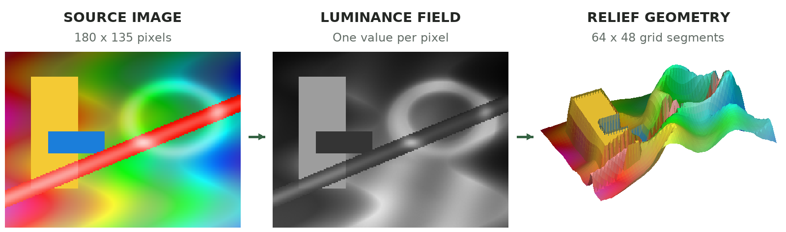

# Rasterform

Rasterform is a browser studio for making reliefs from photographs, graphics, and type. Choose which parts of an image should rise, orbit the resulting surface, and render a still or an animated image sequence. Your artwork is processed on your device.

[Open Rasterform](https://rasterform-atilio.web.app/) · [Open the editable landscape study](https://rasterform-atilio.web.app/?study=mona-lisa)

The featured study starts with a 625 × 690 pixel detail of the winding road on the left of Leonardo da Vinci’s *Mona Lisa*. Its green channel supplies the height field. Eight Strata contours start at 51% of that field’s range. Open **Properties → Geometry** and move **Start level** to see which parts of the landscape remain. [Download the source crop](public/studies/mona-lisa-landscape.png)

The crop preserves the pixels from **(0, 1170)** to **(625, 1860)** in the 1920 × 2861 reproduction. The painting is in the Musée du Louvre. The C2RMF photograph, retouched by Dcoetzee, is public domain on Wikimedia Commons. [Source and licensing](https://commons.wikimedia.org/wiki/File:Mona_Lisa,_by_Leonardo_da_Vinci,_from_C2RMF_retouched.jpg)



## Make a piece

1. In **Image**, open the demo or choose your own image. Start with **Luminance** to raise brighter pixels. Try **Hue**, **Edges**, or a combination of channels to bring out a different part of the picture. In **Text**, type a word and adjust its extrusion and bevel.
2. Choose a geometry. **Solid relief → Cut to transparency** follows the outline and holes in a transparent PNG. **Strata** turns a height field into stacked contour sheets. Raise **Start level** to let low regions drop out of the stack.
3. Orbit the form and choose its appearance. **Photo** keeps the source colors, **Height** colors the surface by elevation, and **Clay** shows how light falls on a matte, glossy, or metallic finish.
4. To animate the form, enable **Living Form**. Try **Expand** on a Strata stack to open and close its gaps.

**Keep version** stores a comparison for the current session. After a reload, **Recover session** can restore the latest saved design in the same browser.

## Download your work

Open **Export** to preview the composition and choose an output.

| Output | What you get |
| --- | --- |
| Still | A PNG up to 2,048 pixels on the long edge. **High** supersamples the image. **Final** path traces shaded surfaces and takes longer. Image work supports the current camera or a straight-on view. |
| Living loop | A ZIP of numbered, lossless PNG frames and a timing manifest, up to 2,048 pixels on the long edge. Choose 12, 24, or 30 frames per second. |
| Height PNG | The processed grayscale height field at working resolution in the Image workspace. White represents the highest elevation. |

Stills and loops can include transparency or use the current studio background. A still captures the visible pose. To assemble a movie, import the numbered loop frames into your editor as an image sequence at the chosen frame rate.

## Guides

- [From Image to Form, an illustrated artist guide (PDF)](output/pdf/Rasterform_From_Image_to_Form.pdf)
- [Editing, comparisons, and recovery](docs/EDITOR_UX.md)
- [Building and animating contour sheets](docs/STRATA.md)

## Run from source

Use Node.js 22.12 or later. From the repository root:

```sh
npm ci
npm run dev
```

Open the local URL printed by Vite. Use `npm test` to run the tests and `npm run build` to type-check and generate the static site in `dist/`.

Final rendering uses [three-gpu-pathtracer](https://github.com/gkjohnson/three-gpu-pathtracer). The studio lighting uses Sergej Majboroda’s CC0 environment, [Studio Small 08 from Poly Haven](https://polyhaven.com/a/studio_small_08).
