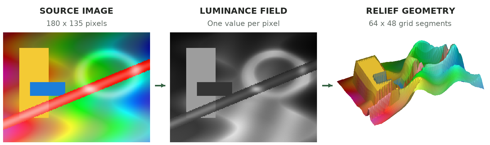

# Rasterform

**Turn color, light, and texture into dimensional form.**

Rasterform is a local 3D form studio for artists, designers, photographers, and creative technologists. Turn a photograph or graphic into a relief, make beveled 3D lettering from an installed font, or build a stack of contour layers. Explore materials and seamless motion, then export an image, a loop, or a model for further work.

The image workflow is **2.5D**: brightness, color, transparency, and edges become height. It interprets the pixels you provide; it does not reconstruct hidden surfaces or infer a photograph's real depth.



*A small generated example of the image → height field → relief mesh pipeline.*

## Download the Mac app

**[Download Rasterform for Apple silicon Macs (.zip)](https://github.com/lolusername/rasterform/releases/download/v1.0.0-preview.20261011/Rasterform-macOS-arm64.zip)** · [Release notes and checksums](https://github.com/lolusername/rasterform/releases/tag/v1.0.0-preview.20261011)

This download contains **Rasterform.app** for **Apple silicon Macs (M1 or newer), macOS 12 Monterey or later**. You do not need Node.js, npm, or the source code to use it. Intel, Windows, and Linux binaries are not included in this release.

1. Download and unzip `Rasterform-macOS-arm64.zip`.
2. Open `Rasterform.app` from the extracted folder to try it, or drag it into **Applications** to install it.
3. Import a PNG, JPEG, or WebP, or choose **Text** and start typing.

**This is a preview build.** It is ad-hoc signed, but is not Developer ID-signed or notarized by Apple. If macOS blocks the first launch and you trust this download, use **System Settings → Privacy & Security → Open Anyway** after attempting to open it. See [Apple's instructions](https://support.apple.com/en-us/102445) and the [installation guide](docs/INSTALLING_MACOS.md).

### Do I need Blender?

**Blender is optional.** Editing, High/Final PNG renders, Living Loop exports, GLB, STL, and `.rasterform` project files work without it.

Install **Blender 5.2 LTS or newer (minimum 5.2.0)** only if you want:

- **Cycles Pro** still rendering, which saves an AgX PNG and a matching multilayer EXR for compositing.
- **Blender project (.blend)** export, with packed source textures and Exact, Balanced, or Lightweight topology.

Get the Apple silicon version from the [official Blender 5.2 LTS release page](https://www.blender.org/releases/5-2/) and place `Blender.app` in **Applications**. Blender is not bundled with Rasterform. The app checks its version before enabling these features and launches its own background process for each job. You can keep another Blender project open; both applications share your Mac's GPU and memory.

## Make a piece

1. **Choose Image or Text.** Use brightness, hue, saturation, RGB channels, alpha, or edges as image height signals. Text has extrusion, bevel, tracking, line-height, and alignment controls.
2. **Shape the form.** Blend channels, adjust depth and smoothing, or use Blob to round the result. **Strata** builds separately closed contour layers with adjustable thickness and gaps.
3. **Choose an appearance.** Keep the original colors, map height to a gradient, try matte/glossy/metallic clay, or inspect the wireframe in the HDR studio.
4. **Add motion.** Living Form makes the mesh breathe, ripple, flow, or melt; Strata's Expand opens and closes the stack. Motion loops exactly and preserves the original source and base geometry.
5. **Frame and export.** Use the current camera or, for Image stills, a straight-on view. Choose a transparent background or a flat white, gray, or black studio background.

Undo/Redo, **Keep version**, temporary comparisons, and channel inspection make exploration reversible. Kept versions last for the current session; local recovery can restore the latest design after a reload. Desktop **Save project** creates a complete `.rasterform` file containing the source, settings, material, motion, and camera. Recipe JSON is a lighter description, not a complete project backup.

## Choose an output

| Output | Browser edition | Mac app |
| --- | --- | --- |
| Still PNG, with optional transparency | Up to 2K | High up to 8K; Final/Cycles Pro up to 4K |
| Source-sized, straight-on Image still | Fitted within 2K | Exact original dimensions through High; Final/Pro limited to 4K |
| Living Loop PNG-sequence ZIP | Up to 2K | Up to 4K |
| Height PNG | Yes | Yes |
| Textured GLB, STL, recipe JSON | — | Yes; no Blender required |
| Complete `.rasterform` projects | Local recovery only | Save and open |
| Editable `.blend` and Cycles Pro PNG/EXR | — | Requires Blender 5.2.0+ |

**High** uses 2× rendering. **Final** is the built-in path tracer, with 6,144 samples for diffuse/matte work and 8,192 for glossy/metallic work. **Cycles Pro** uses the optional Blender renderer. On desktop, Final runs in a separate renderer process so the studio stays responsive; browser Final may pause editing while it renders. Full-quality stills can take several minutes.

Loops are lossless RGBA PNG sequences with a timing manifest, ready to assemble in a video or compositing tool. They use High quality; Final and Cycles Pro are still-render paths. GLB, STL, and `.blend` bake the visible motion phase rather than exporting animated geometry. Camera and studio lights are not included in model exports. Strata preserves separately named layers in GLB and `.blend`; STL contains separate shells rather than a fused fabrication-ready union.

Image model exports embed the original-resolution bitmap as an **8-bit sRGB PNG**, with neutral sides and back. They preserve source dimensions, not arbitrary high-bit-depth or wide-gamut encoding. STL export requires watertight topology. Text fonts must be available or explicitly embedded; check the font license before distributing projects with embedded font bytes.

## Local by design

Your artwork is processed on your device. There is no account, artwork upload, analytics, or remote inference. The desktop package includes its UI, renderers, and studio HDR image and works offline; optional Blender work also runs locally. The browser edition's UI stylesheet requests hosted fonts, but image processing stays in the browser. Session recovery is local storage, so save a desktop project when you need a portable backup.

## Run or build from source

Use **Node.js 22.12 or newer** to work with both editions. Vue, TypeScript, and Vite power the studio; Three.js handles geometry and preview rendering, and `three-gpu-pathtracer` supplies Final. The optional Electron shell owns native files and isolated render jobs. There is no backend or database to configure.

```bash
git clone https://github.com/lolusername/rasterform.git
cd rasterform
npm ci
npm run dev
```

Build and check the browser edition:

```bash
npm test
npm run build
```

Build the Mac app on an Apple silicon Mac:

```bash
npm --prefix electron ci
npm run desktop:package:arm64
npm --prefix electron run smoke:packaged:existing:arm64
```

The result is `electron/out/Rasterform-darwin-arm64/Rasterform.app`. Packaging does not install it. `npm run desktop:dev` builds and launches the development app; `npm run desktop:build` stages it without producing an installable bundle.

Maintainers can explicitly build Intel or universal packages with `desktop:package:x64` or `desktop:package:universal`. These are not the downloadable, tested Apple silicon artifact. `desktop:package:lab:arm64` creates a separate **Rasterform Renderer Lab.app** for experiments. Local packages are ad-hoc signed; Developer ID signing and notarization require the separate release process described in the desktop guide.

## Guides and credits

- [Install, launch, update, and remove the Mac app](docs/INSTALLING_MACOS.md)
- [Editing, comparisons, recovery, and verification](docs/EDITOR_UX.md)
- [Strata controls and export behavior](docs/STRATA.md)
- [Desktop architecture, render settings, platform policy, and release verification](docs/DESKTOP.md)
- [Technical teaching case study](docs/interview/README.md)

Final rendering uses [three-gpu-pathtracer](https://github.com/gkjohnson/three-gpu-pathtracer). Studio lighting uses **Studio Small 08** by Sergej Majboroda from [Poly Haven](https://polyhaven.com/a/studio_small_08), provided under CC0. Optional Pro rendering uses Blender Cycles and its OpenImageDenoise integration.
