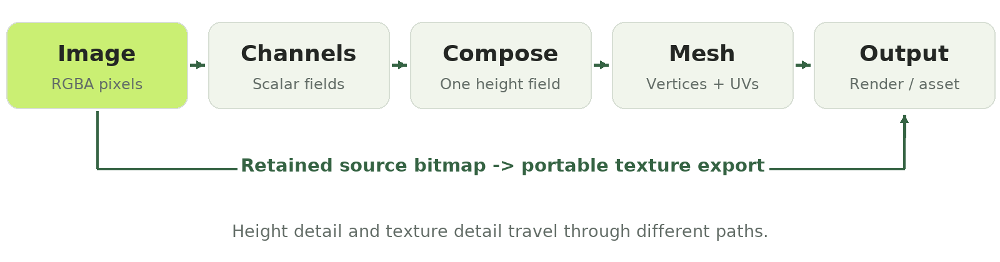
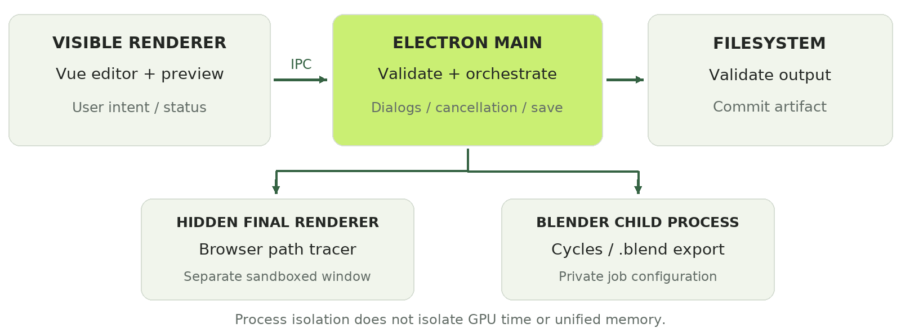
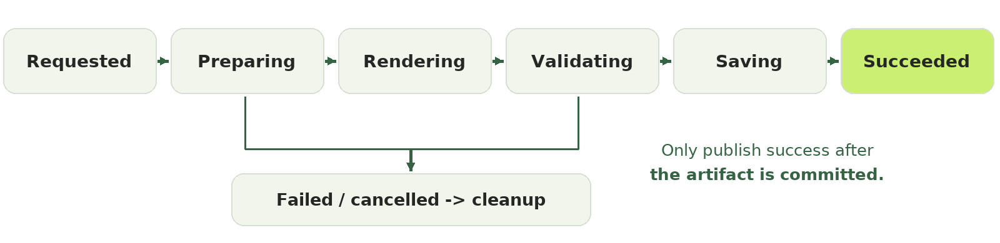

# Rasterform

## From pixels to reliable GPU-rendered assets

A technical teaching case study and interview preparation packet for Atilio Barreda II.

Prepared for the CoreWeave content discussion with Cole. This packet uses Rasterform as the portfolio-piece option in the supplied candidate instructions. The separate sample-document exercise is discussed in an appendix; the original attachment is unchanged.

> Central idea: A preview shows what an application can draw. A trustworthy export proves what a user can take away.


The figure uses Rasterform's actual demo-image, channel, and mesh functions. The relief is an explanatory projection of their geometry, not a screenshot or a High, Final, or Cycles Pro render.

### How to use this packet

- **Teach:** Use the problem, pixel-to-mesh example, quality comparison, process diagram, and export lesson. Do not read the entire packet aloud.
- **Rehearse:** Follow the timed route and two-minute demo plan. Keep the rendered examples in this PDF available if the application is unavailable.
- **Prepare:** Use the engineering notes, Q&A, evidence register, and sample-document critique for deeper discussion.

**Evidence snapshot:** source commit `7f49da7`; checked September 14, 2026. Application code was not changed for this report. The exact job description was not supplied, so role-specific expectations are not assumed.

<!-- page -->

## The problem and the promise

Rasterform turns a flat image into a controllable **2.5D relief**: a surface whose height comes from image information. It is useful for dimensional graphic assets, material studies, title treatments, and short motion loops. It compresses a repeatable creative workflow into a focused tool instead of asking the user to construct a general-purpose 3D scene first.

The important distinction is that this is **interpretation, not reconstruction**. A bright region can become a peak because the artist chose brightness as the height rule. The application has not inferred the true shape, scale, or hidden back of the photographed object. Image mode does not use a learned depth model or a remote AI inference service. [R1-R3]

### What the learner should be able to do

By the end of the lesson, the learner should be able to explain how pixels become triangles; distinguish mesh detail, output dimensions, and render sampling; and describe why a completed computation is not yet a successfully delivered file.

| Requirement | Consequence for the design |
| --- | --- |
| Direct, understandable creative control | Expose image channels, layer blending, and field operations instead of an opaque shape generator. |
| The model should be the only visible object | Do not add a floor or grid to the output scene. A background color is not geometry. |
| High-quality exports, even when they take minutes | Preserve the selected render contract; improve scheduling and isolation without silently lowering quality. |
| A usable browser and desktop experience | Share the creative core, but make platform-dependent export limits explicit. |
| Assets that survive a handoff | Validate dimensions, material data, embedded images, and actual reopen behavior. |

### A precise boundary

The source code calls one surface mode `plane`. Here that means the **image-derived model itself**, with height `z = h * depth`; it is not an extra background plane. Solid mode adds side walls and a back. Neither mode makes the result a complete reconstruction of a real object. [R3]

> Opening question: If two pixels look equally bright but have different hues, must they become the same height? Only if brightness is the selected rule.

<!-- page -->

## Follow the data, not the interface

The most useful mental model is a sequence of representations. Each stage has a different job and a different definition of correctness.



### The processing path

1. **Decode an image.** PNG, JPEG, and WebP inputs become an RGBA working raster, normally capped at a 1,280-pixel long edge. The original compressed upload is retained for full-resolution texture export. Initial decoding can still allocate the original bitmap; the working cap does not eliminate that peak. [R1]
2. **Extract scalar fields.** A channel maps each pixel to one number, usually between zero and one. Luminance, hue response, saturation, value, RGB, alpha, and edges are available. [R2]
3. **Compose and process.** Ordered layers combine fields. Global blur, contrast, inversion, quantization, and optional Blob operations alter the result. [R2]
4. **Build geometry.** Sample the field onto an aspect-preserving grid, assign a height to each vertex, and connect vertices into triangles. Compute normals for shading. [R3, R4]
5. **Render or transfer.** Render a PNG, produce a motion sequence, or, on desktop, transfer mesh and material data into a model format. [R5-R9]

### Why the retained-source branch matters

The field used to shape a mesh and the bitmap used to color it do not need the same resolution. A moderate-resolution surface can carry a sharper texture. Conversely, adding more texture pixels cannot repair an undersampled silhouette. The export path preserves original image dimensions separately from the interactive working raster. [R1, R8]

> Check understanding: A 4,000-pixel source, a 128-segment mesh, and a 2,048-pixel render describe three different things. None of those numbers is the number of path-tracing samples.

<!-- page -->

## How a pixel becomes a height

Consider luminance mode with blur, contrast, inversion, and quantization disabled. Display-encoded sRGB values are first converted into linear-light values. For a normalized channel value `c`, the implementation uses: [R2]

```text
linear(c) = c / 12.92                    when c <= 0.04045
linear(c) = ((c + 0.055) / 1.055)^2.4     otherwise

Y = 0.2126 * Rlinear + 0.7152 * Glinear + 0.0722 * Blinear
z = Y * depth                            in plane mode
```

At a depth of `0.6`, black becomes height `0`, white becomes `0.6`, and ideal normalized mid-gray (`R = G = B = 0.5`) becomes approximately `0.1284`, not `0.3`. Its linear-light value is approximately `0.214`. An actual 8-bit gray sample will differ slightly because 0.5 is between integer code values. [R2, R3]

### Why this is worth teaching

The conversion makes the rule explicit. It is not a claim that perceived brightness, artistic depth, and physical luminance are interchangeable. The artist can deliberately select another channel or change the contrast when a different relief is more useful.

### Hue has a seam unless you treat it as a circle

Hue wraps: 359 degrees and 1 degree are neighbors, not opposite ends of a line. Rasterform uses a cosine response around a selected hue origin, multiplied by saturation. Low-saturation pixels contribute less because gray does not have a meaningful dominant hue. [R2]

```text
hueResponse = ((cos(2 * pi * (hue - origin)) + 1) / 2) * saturation
```

Edges use normalized Sobel gradient magnitude. They describe local image changes, not object boundaries discovered by an AI system. Because magnitudes are normalized against the image maximum, the response is relative to the input. [R2]

> Ask, then reveal: With luminance alone, which produces more height: pure green or pure blue? Green, because its linear-light coefficient is larger. That is a mapping decision, not a statement that green objects are physically taller.

<!-- page -->

## Composition makes the mapping art-directable

A single channel can be too literal. Rasterform lets the artist combine several fields non-destructively. The first enabled layer establishes the base, scaled by its strength. Later layers use normal, add, subtract, multiply, screen, maximum, or minimum blending. Results are clamped after each stage. [R2]

For subsequent layers, the selected blend computes a target, then strength interpolates from the current base toward that target:

```text
result = clamp(base + (target - base) * strength)
```

### Order changes the shape

Start with height `0.2`. Add a layer valued at `0.6` at half strength, then multiply by `0.5` at full strength: the result is `0.25`. Reverse the two operations and the result is `0.4`. Layer order is therefore meaningful, not merely how the interface happens to display a list. [R2]

### Global operations have different purposes

| Operation | What it changes |
| --- | --- |
| Blur | Reduces small spatial variations before meshing; useful when fine image noise would become unwanted spikes. |
| Contrast | Expands or compresses values around the midpoint; the factor is `2^(contrast/50)`. |
| Invert and quantize | Reverse the height ordering or constrain it to a chosen number of levels. |
| Blob dilation | Expands high-value regions using a grayscale maximum filter. It can merge neighboring raised areas. |
| Blob smoothing | Rounds transitions after dilation using repeated box-filter passes. |

The implemented order is blur, contrast, inversion, quantization, and then optional Blob dilation and smoothing. Changing this order would change the output. Dilation uses an efficient separable maximum filter; the smoothing uses three linear-time box passes as a Gaussian approximation. [R2]

> Blob is not Blender's Shade Smooth. Shade Smooth changes how normals are interpolated for lighting; Blob changes the field and therefore the actual surface. A smoother-looking highlight alone is not proof of smoother geometry.

<!-- page -->

## A mesh is a sampling decision

In image mode, the long side of the grid has 8 to 256 segments. The shorter side follows the image aspect ratio, with a minimum of four segments. Bilinear sampling estimates field values between raster samples. Positions, colors, UVs, heights, and triangle indices are stored in typed arrays. [R3]

For `C` columns and `R` rows:

```text
Surface vertices = (C + 1) * (R + 1)
Surface triangles = 2 * C * R
Solid vertices = 2 * (C + 1) * (R + 1)
Solid triangles = 4 * C * R + 4 * (C + R)
```

A square 256-segment surface has 66,049 vertices and 131,072 triangles. Closing it with a back and side walls produces 132,098 vertices and 264,192 triangles. Doubling each grid dimension approximately quadruples the surface work; it does not merely double it. [R3]

### Three height conventions

- **Plane:** `z = h * depth`.
- **Centered:** `z = (h - midpoint) * depth`.
- **Solid:** the front uses `max(0.025, baseThickness + (h - midpoint) * depth)`; the back is at zero.

These equations explain why a centered surface can cross its reference level, while solid mode maintains a minimum front-to-back thickness. They do not describe an additional floor in the scene. [R3]

### What mesh health can and cannot prove

The topology inspector checks boundary edges, non-manifold edges, degenerate faces, and connected components. These are useful structural tests. Its watertight result is not a complete proof against self-intersection, nor a certification that a shape can be manufactured. Image alpha used as a height channel does not automatically remove triangles. [R3]

Text mode is a separate construction path: a font mask becomes contours and extruded geometry, including letter counters and bevels. It should not be described as another rectangular image-height grid. [R3]

> Teaching shortcut: The mesh is the scaffold; the texture is paint on that scaffold. Neither output resolution nor extra render samples can create silhouette detail that the scaffold never contained.

<!-- page -->

## Materials and textures must survive the handoff

A mesh position says **where** a point is. A normal helps determine **how light interacts** with the surface. UV coordinates say **where to sample an image**. Material parameters describe properties such as base color, roughness, and metalness. These data serve different purposes. [R3, R4, R8]

### Vertex color is not an embedded bitmap

Rasterform's interactive geometry samples source colors at vertices. Those colors interpolate across triangles. A portable bitmap export instead needs actual image bytes, UVs, and a material that references the image. Merely finding UV coordinates or color attributes in a GLB does not prove that it contains the selected texture. [R8]

For supported original-image exports, the retained source is decoded at its original dimensions and normalized to an orientation-correct, 8-bit sRGB PNG. That is a lossless PNG encoding of the normalized bitmap, not a promise to preserve the original file bytes, wide-gamut profile, or HDR precision. Limits on dimensions and payload size are enforced. [R8]

### The double-tinting trap

In glTF, vertex color multiplies material base color. If the same image supplies both the texture and the vertex colors, leaving both enabled can darken or alter the result. Rasterform removes the redundant color attribute for its textured export, embeds the PNG payload, and uses source UVs on the front with a separate neutral side/back material. The live preview geometry is not rewritten to accomplish this. [R8; E3]

### GLB and .blend solve different handoff problems

| Format | What the user receives |
| --- | --- |
| GLB | A portable binary asset with geometry and supported material data, including the embedded bitmap when applicable. It is useful beyond Blender. |
| .blend | A Blender-native project containing the mesh, assigned materials, and a packed image. Retopology options can provide a more editable mesh and UV layout. |

Retopology preserves a dedicated source-image UV mapping while providing an editable UV map where supported. Exact, Balanced, and Lightweight options are choices about topology and approximation, not a guarantee that every shape becomes production-perfect. Unsupported textured freeform cases are rejected instead of silently stretching the image. [R8]

> Same material inputs do not guarantee identical pixels in every renderer. Lighting, exposure, tone mapping, and shader implementations can differ. A model export is not a copy of the full Rasterform lighting and compositing scene.

<!-- page -->

## Rendering quality is not one number

Rasterform integrates established rendering systems. It does not implement a new rendering engine from scratch. Three.js supplies the WebGL scene and rasterizer; three-gpu-pathtracer supplies browser-compatible path tracing; the optional desktop Pro route runs Blender Cycles. [R4-R7; E1]

**Rasterization** projects triangles onto pixels and shades their visible fragments. **Camera-based path tracing** samples paths through the scene, including reflection and transmission, to estimate the light reaching each pixel. A bounce is a further surface interaction. A **bounding volume hierarchy (BVH)** groups geometry into nested bounds to accelerate ray-intersection tests. [E1, E5]

| Route | Method and current quality contract | Best teaching description |
| --- | --- | --- |
| Preview / High | Interactive rasterization; High renders at 2x each output dimension and downsamples. | Fast feedback and clean rasterized export. Four times the intermediate pixel area, not four path samples. |
| Final | Path tracing: 6,144 samples for non-specular-clay cases; 8,192 for glossy or metallic clay; four bounces and two transmissive bounces, plus denoising. | More complete sampled light transport with a fixed requested sample target. |
| Cycles Pro | Desktop Blender job; defaults include max 8,192 samples, min 512, adaptive noise threshold 0.001, 12 maximum bounces, and guided Open Image Denoise. | A separate renderer with explicit advanced settings and PNG plus EXR output. |

Final's 8,192-sample condition is specifically the glossy/metallic **clay appearance** check, not an automatic classification of every shiny-looking pixel. Pro uses adaptive sampling, so the maximum is a ceiling, not a claim that every pixel receives that many samples. The user can explicitly change Pro settings. [R6, R7]

### Four separate controls

**Working-image resolution** limits field information. **Mesh resolution** limits geometric detail. **Output dimensions** set the image's pixel count. **Samples and bounces** control parts of the light-transport calculation. A 2K path-traced image can be noisy; an 8K raster image can have smooth edges but simpler lighting.

For an ordinary independent-sample Monte Carlo estimate, random error tends to fall approximately with the square root of sample count: roughly four times the samples for half the noise. Denoising can help, but can also remove detail. Neither principle fixes systematic shader bugs or guarantees an artifact-free image. [E5]

> The product contract is explicit: a scheduling budget is not permission to reduce quality. Final does not silently replace the requested path-traced output with a rasterized fallback. Long render time is preferable to a falsely labeled result. [R6]

<!-- page -->

## Bigger exports do not need a bigger visible canvas

The display viewport is a composition tool. The export target is an output specification. Their dimensions should be independent. Rasterform uses separate export canvases and cameras so a large render does not require enlarging the on-screen editor. [R5, R6]

### Tiling bounds part of the problem

High uses overlapping tiles with supersampling and downsampling. Final bounds the core output tile edge at 1,024 pixels and adds overlap for filtering. Separately, its path tracer uses a 3 by 3 internal work subdivision. These are two levels of tiling, not two descriptions of the same tile count. [R5, R6]

The code yields between manageable batches and throttles progress updates. Final's approximately six-millisecond batch budget helps scheduling; it is not a six-millisecond total render deadline, and it does not change the sample target. Shader compilation or other synchronous setup can still stall a browser before a yield point. [R6]

### Memory is not just the finished PNG

| Square output | One uncompressed RGBA8 buffer | At twice each dimension |
| --- | --- | --- |
| 2,048 x 2,048 | 16 MiB | 64 MiB |
| 4,096 x 4,096 | 64 MiB | 256 MiB |
| 8,192 x 8,192 | 256 MiB | 1 GiB |

These are arithmetic examples, not measured peak process memory or a promise that every route supports 8K. Float render targets, denoising buffers, mesh copies, BVHs, browser overhead, and encoding add more. Tiling reduces render-target pressure, but the current still-image path can retain a full output canvas. It is not constant-memory at arbitrary dimensions. [R5-R7]

### Straight-on is a framing option

The desktop straight-on route aligns an export camera in front of the model and can use the source image's exact dimensions in High. It preserves the editing camera. It uses a front-aligned perspective camera, so it should not be described as a mathematically orthographic projection. Matching dimensions also does not recover lost geometric detail. [R5]

> Practical lesson: Split responsiveness, throughput, memory use, and image fidelity into separate questions. One optimization rarely improves all four without a tradeoff.

<!-- page -->

## Process isolation protects the editor

The desktop app separates interactive editing, privileged operating-system work, and expensive rendering. This is the most direct systems lesson in the project. [R6, R7, R9]



### Responsibilities, not just boxes

- **Visible renderer:** Vue interface, preview, and user intent. It is sandboxed, with context isolation and Node integration disabled.
- **Electron main process:** validates IPC requests and sender/job identity; owns file dialogs, job orchestration, cancellation, and file saving. It is not the path-tracing engine.
- **Hidden Final renderer:** a separate sandboxed BrowserWindow runs the browser path tracer without tying its JavaScript work to the visible editor. This is neither a Web Worker nor Electron's offscreen-rendering mode.
- **Blender child process:** runs Cycles or a native project-export job with background/factory-startup options, disabled auto-execution, and private job configuration. It does not operate the user's already-open Blender project.

The browser-only Final route stays on the browser's main thread, with cooperative yielding where possible. A BVH worker is used inside the rendering stack, but that does not mean the entire render is in a worker. Module loading, WebGL context ownership, worker nesting, and synchronous compilation are real boundaries. [R6]

### Separate process does not mean separate hardware

An open Blender project and Rasterform can coexist, but they still compete for GPU time and unified memory on Apple silicon. Isolation reduces accidental state sharing and some UI stalls; it does not promise zero slowdown, eliminate out-of-memory conditions, or create another GPU. Pro selects a compatible Metal device when available and otherwise uses CPU rendering. [R7, R9]

> A responsive interface with a render stuck at preparation is still a broken workflow. Isolation has to preserve successful execution.

<!-- page -->

## Completion is an artifact contract

A progress bar is a report about work. A saved artifact is the result the user asked for. Treating those as equivalent creates false success states.



The diagram is a teaching model of the implemented responsibilities, not the exact names of a single application enum. Main-process handlers validate job identity and input shape. Late messages must not complete a newer job. Cancellation targets the requested job and cleans up its resources; it should not kill unrelated Blender work. [R9]

### Publish only after validation

For a single desktop image, the save path writes a unique sibling temporary file, flushes and closes it, then renames it into place. Success should describe a validated, committed file, not merely an in-memory buffer or a render-complete event. A Pro PNG/EXR pair needs coordinated validation and recovery; two files are not one filesystem-atomic transaction. [R7, R9]

| Failure | What must remain true |
| --- | --- |
| Shader setup fails | Report the actual failure; do not label a raster fallback as Final. |
| A job is cancelled while compilation is blocked | Allow the worker window/process to be retired; do not accept its later result for another job. |
| Encoding or saving fails | Do not show success just because sampling reached its target. Preserve or recover prior destination data where supported. |
| Texture metadata exists but the image is absent | Reject the handoff as incomplete; UVs and a filename are not image payloads. |

### Debugging should follow the stage boundary

If a render stays at preparation, inspect module loading, BVH construction, shader compilation, and process messages before changing sample counts. If it samples but looks patterned or non-finite, inspect the sampler and shader path. If it renders but produces no file, investigate validation, encoding, and commit. Each symptom suggests a different owner. [R6, R9]

Version-sensitive shader compatibility code and finite-sample guards need regression tests when dependencies change. They do not prove that every GPU/driver combination is qualified. [R6]

<!-- page -->

## Motion and platform scope

Living Form applies deterministic deformation to the base mesh. Breathe, ripple, flow, and melt are procedural behaviors, not a fluid simulator or a learned animation model. Each phase starts from the immutable base geometry, avoiding accumulated deformation drift. [R10]

For a four-second loop at 24 frames per second, there are 96 frames. Evaluate phase `i / 96` for `i = 0...95`; do not include a duplicate phase-one endpoint. The next playback frame is phase zero again. This avoids an extra repeated frame at the loop boundary. [R10]

Motion export produces lossless RGBA PNG sequences through the High supersampled route, not Final path tracing per frame. Its manifest records timing, dimensions, seed, and settings. ZIP streaming can use origin-private storage where supported; that path still needs storage checks and cleanup. A static mesh export captures the visible phase, not an animated GLB. [R10]

### Shared core, intentionally different exports

| Capability | Web | Desktop |
| --- | --- | --- |
| Image and text creation, materials, Blob, Living Form | Shared creative controls | Shared creative controls |
| High stills | Up to 2K long edge | 2K, 4K, 8K; exact source dimensions with straight-on High |
| Final stills | Up to 2K long edge | Up to 4K long edge |
| Cycles Pro | Not available | Up to 4K; local Blender required |
| PNG motion sequence | High, 2K | High, 2K or 4K |
| GLB, .blend, STL, recipe JSON | Not exposed; image-only edition | Available with format-specific eligibility and checks |
| Alpha background | Optional | Optional |

The table describes the checked-out implementation, not a fresh audit of a deployed website or installed app. Export dimensions are long-edge presets except where exact-source dimensions are explicitly selected. [R5-R10]

### Reproducibility has a boundary

Recipe version 6 records parameters and source metadata. It is not a self-contained project archive containing source-image bytes or font files. A deterministic seed helps reproduce motion only when the base asset, parameters, code, fonts, and relevant environment also match. Do not promise bit-identical rendering across GPUs. [R1, R3, R10]

<!-- page -->

## A two-minute demonstration that teaches

The point of the demo is to let the learner predict a result, not to race through every control. Use Rasterform's built-in deterministic image so there is no private asset, missing upload, or licensing question. Keep this PDF open as a fallback.

### Preflight before the interview

- Open the intended browser or desktop build and confirm its version. The checkout validation in this report does not prove that the installed app is current.
- Select image mode and the demo image. Start with one enabled luminance layer at full strength; disable other layers and field effects. Keep depth moderate and the background plain.
- Verify one High 2K PNG export to a known folder. Reopen it and check its dimensions and alpha behavior. If showing Blender, reopen a prepared bitmap-textured export as well.
- If you want to show Final or Pro quality, prepare a genuine full-quality result in advance and record its settings. None was newly rendered for this report. Do not substitute concept art or the diagram on the cover.
- Record a short screen capture or keep still screenshots before the meeting. Turn off notifications. Do not start a minutes-long quality render just to fill the demonstration slot.

### Live sequence

1. **Predict, 20 seconds.** Ask which bright part of the image will become a high region. Reveal the relief and rotate it slightly.
2. **Change the rule, 25 seconds.** Switch the same layer from luminance to hue and adjust its origin. Point out that the image stayed constant while the interpretation changed.
3. **Change the surface, 25 seconds.** Enable Blob or modest blur. Explain that this changes geometry, not only the appearance of its normals.
4. **Separate resolutions, 25 seconds.** Show mesh detail and output dimensions as independent controls. Return to a prepared clean state.
5. **Show the artifact, 25 seconds.** Open the already-verified PNG. If useful, show the packed image in the prepared Blender file. State exactly which route created each result.

### Fallback that still accomplishes the lesson

If the UI or GPU is unavailable, use the cover's three-panel example and the pixel-to-height equation. Ask the same prediction question and trace the same representation changes. The learning objective survives without a live render.

> Check for understanding: Why might a 4K export still have an angular outline? Its mesh can be too coarse. Increasing output pixels samples that same coarse outline more finely; it does not add vertices.

<!-- page -->

## The 15-20 minute teaching route

This is a guided lesson, not a chronological account of building the app. Use the deep technical pages as reference material for questions.

| Time | What to show | What the learner should understand |
| --- | --- | --- |
| 0:00-2:00 | Problem and three-panel example | A flat image becomes an art-directed relief, not a reconstructed object. |
| 2:00-5:00 | Data flow and one numeric height | Pixels, fields, and meshes are different representations with explicit rules. |
| 5:00-7:00 | Two-minute demonstration | Changing a channel changes interpretation; Blob changes actual geometry. |
| 7:00-10:00 | Rendering comparison and memory table | Resolution, samples, quality, latency, and memory must be discussed separately. |
| 10:00-13:00 | Process and lifecycle diagrams | Responsiveness is an architecture concern; successful export includes validation and saving. |
| 13:00-15:00 | Texture handoff and tradeoffs | An embedded, reopenable asset is a stronger result than a correct preview. |
| 15:00-17:00 | Optional CoreWeave connection | GPU jobs share resource, isolation, observability, and artifact-delivery concerns. |
| 17:00-20:00 | Questions or deeper example | Use evidence and state the boundary of what was tested. |

If the slot is 15 minutes **including questions**, use 12 minutes of teaching and reserve three: shorten the demo to one mapping change and omit the cloud-design extension. If the interviewer expects 15-20 minutes of presentation followed by questions, use the full route. Clarify the timing at the start.

### Suggested opening

"I'm going to show how a flat image becomes a dimensional graphic asset, then explain why producing the final file is a systems problem as well as a graphics problem. You don't need a graphics background. By the end, you should be able to distinguish the shape's detail from the image's resolution, and a finished render from a successfully delivered asset."

### Suggested closing

"The through-line is representation and trust: make the mapping understandable, make the quality contract explicit, and validate the artifact that leaves the application. Those principles matter whether the job runs in a browser, on a desktop GPU, or in a managed compute environment."

These are suggested teaching scripts, not claims about personal authorship. Adapt them to your own language and actual contribution.

<!-- page -->

## Questions to prepare for: graphics

### Is this really 3D? What makes it 2.5D?

The output has 3D vertices and can be rotated and lit. In image mode, however, the front is generated by one height for each position on a two-dimensional grid. It does not infer arbitrary overhangs or hidden surfaces. Closing the back makes a solid relief, not a general reconstruction. Text follows its own contour/extrusion path.

### Why not just use Blender?

Blender can perform many of these operations and is the more general environment. Rasterform's value is the opinionated workflow: image-channel interpretation, immediate shape control, and a small set of asset handoffs. The defensible claim is lower setup and conceptual overhead for this task, not that Blender is incapable. No comparative time-on-task study was performed.

### Is the renderer something you wrote yourself?

No. Rasterform integrates Three.js, three-gpu-pathtracer, and optional Blender Cycles. Its own engineering includes the channel/mesh pipeline, interaction model, rendering configuration, process orchestration, export contracts, and validation. Credit the dependencies for the rendering algorithms they provide.

### Why can a high-resolution render still be noisy?

Output resolution counts pixels. Path-tracing noise comes from estimating light transport with a finite sample budget, especially for difficult specular paths. More pixels do not automatically mean better estimates per pixel. Inspect sampling and denoising before assuming that another resolution preset will help.

### Does denoising reduce quality?

It is a reconstruction tradeoff: less noise can come with lost fine detail or artifacts. Rasterform's named routes have explicit denoising settings; hiding a lower sample count behind a time target is a different, unacceptable behavior. Evaluate final imagery with representative glossy, metallic, high-contrast, and transparent-edge cases.

### Does retopology make the model professional?

It can make a mesh more editable or economical. It can also alter shape and detail. Structured heightfield rebuilding suits image reliefs; QuadriFlow is used for supported irregular cases. Neither is a universal guarantee of animation-ready edge flow. Texture alignment, silhouette error, and reopen behavior still need inspection.

### Will my metallic or glossy look be identical in Blender?

Supported material values and the selected bitmap can travel with the asset. Exact appearance depends on the destination lights, environment, color management, and shader. A packed texture removes one source of failure; it does not transport every rendering condition.

Source basis: R1-R8. These answers describe the current implementation and its limits, not an evaluation of every alternative graphics tool.

<!-- page -->

## Questions to prepare for: systems and product

### Why did moving work off the UI not solve everything?

A worker or process is a new execution environment with its own initialization, messaging, and graphics constraints. A responsive UI with a render that never starts is still a broken workflow. The current desktop split isolates Final's JavaScript work; browser Final uses cooperative scheduling. Neither removes synchronous setup costs or shared GPU pressure.

### Can it render while another Blender project is open?

Yes, the Pro/export route starts an isolated background Blender process instead of driving the open session. It can still slow that session because both jobs consume the same hardware. Do not promise interference-free performance under memory pressure.

### What would you measure to improve performance?

Instrument stage durations: input decode, field processing, mesh construction, BVH construction, shader preparation, sampling, denoising, encoding, and save. Track peak memory, cancellation latency, failures, and actual completed artifacts. Compare the same scene and quality contract. This is a proposed profiling plan, not a benchmark already completed for the report.

### How do you know the system works?

The current checkout passes 283 tests across 38 files and a production build. The suite includes actual Blender project-export and reopen checks. That is stronger than testing only message shapes, but it is not a full GPU/device qualification or a newly completed high-quality visual render. State both sides of that evidence.

### What would you improve next?

Make export stages and failure ownership more visible; add a small reference-image regression set on supported devices; and package a truly self-contained project snapshot for reproducible handoffs. These are proposed improvements, not features this report claims are implemented. Avoid adding breadth before making existing quality and recovery behavior easier to verify.

### Is Electron the same as a native Metal app?

No. It packages a Chromium-based interface with operating-system integration. Desktop packaging enables controlled processes, file access, and a local Blender route; it does not automatically rewrite browser shaders for Metal or improve pixels by itself. The quality improvement comes from an actual rendering path and its settings.

### What is the hardest tradeoff?

Keeping exploration quick without redefining export success. A user may accept a long, explicit Final job while expecting the interface to stay understandable and the delivered file to preserve quality. That requires honest progress, cancellation, resource boundaries, and validation, not a guessed deadline.

Source basis: R5-R10 and the validation snapshot. Profiling and future-work statements above are recommendations, not measured results.

<!-- page -->

## The CoreWeave connection: a careful extension

Rasterform is not deployed on CoreWeave and does not currently use Kubernetes for rendering. The connection is conceptual: rendering is a GPU workload with input artifacts, environment dependencies, long-running execution, resource limits, and outputs that must be validated.

CoreWeave describes CKS as its managed Kubernetes service for containerized workloads, including GPU use. That makes job orchestration a relevant discussion topic, not evidence that Rasterform already uses those services. [E2]

### A possible future batch-render design

```text
Explicit user opt-in
  -> upload immutable input and pinned render specification
  -> queue a job with a stable identifier
  -> run a containerized GPU rendering process
  -> validate output dimensions, format, and expected files
  -> publish an output manifest and offer the download
```

This is a proposal. A portable Blender job would need a Linux-compatible environment, the correct GPU backend, licensed input assets, dependency versions, storage, authentication, and failure handling. Apple Metal configuration cannot simply be copied to a different GPU stack.

### Translate the local lessons

- **Isolation:** replace local process boundaries with an explicit container and tenant boundary. A diagram alone does not establish security.
- **Resource accounting:** request appropriate compute and memory; record duration and cost. A user-set budget should stop or request consent, not silently lower render quality.
- **Reproducibility:** retain input hashes, settings, renderer version, and relevant environment metadata. The current recipe alone is insufficient.
- **Observability:** expose setup, sampling, denoising, validation, and publishing stages so a stalled job has an identifiable owner.
- **Retry safety:** use a stable job key and attempt-specific temporary outputs. Publish only a validated result, with duplicate-attempt handling.

Kubernetes documents that even a Job configured for one completion and one parallel worker can sometimes start the program twice. Therefore, "one requested job" is not a proof of exactly-once execution. Idempotent publication and safe handling of partial output remain application responsibilities. [E4]

> Interview boundary: Explain the mapping, then say what you would need to investigate. Do not imply operational CoreWeave experience, production scale, or cost savings that this project has not demonstrated.

<!-- page -->

## Appendix: evaluating the sample guide

The three-page attachment, **Access requests and escalation**, describes an onboarding access workflow. The candidate email offers it as an optional editing exercise. This appendix evaluates its content; it does not perform its access, messaging, approval, or escalation instructions. The PDF is preserved unchanged. [A1, A2]

### First fix the decision logic

| Finding | Why it matters | Recommended editorial action |
| --- | --- | --- |
| Page 1 says follow up after 48 business hours; Step 2 on page 2 says 24. | Readers can take conflicting actions while following the same guide. | Ask the policy owner which threshold is intended. Use that value consistently in the summary and procedure. |
| "Business hours" is not operationally defined. | 24 working hours is not necessarily one business day. Time zones and holidays affect the clock. | Define the clock, calendar, start event, and pause conditions. Do not invent a definition. |
| Urgent handling is immediate in one place, qualified by a five-minute wait in another, and unqualified later. | A responder cannot confidently choose when to page. | Confirm the intended urgent decision path and repeat it without changing its conditions. |
| Step 2 assumes a Freshservice ticket after earlier steps introduce other request routes. | Some readers are sent to a system that may not own their request. | Use a request-type table with intake, follow-up, escalation, and the required context. |
| Approval and access propagation are easy to conflate. | An approved request can still leave the user blocked. | Distinguish submitted, awaiting approval, approved but propagating, and confirmed usable states. |

### Preserve what already works

Keep the stated team scope, the distinction between a working norm and a companywide SLA, the least-privilege advice, the instruction to avoid duplicate requests, and the concrete follow-up template. These help a reader take an appropriate next step. Do not promote an anecdotal three-day propagation example into a guaranteed service target. [A1]

### How I would explain the edit

"I prioritized contradictory thresholds and unclear ownership before shortening sentences. An attractive guide can still cause the wrong action. I would confirm policy with its owner, then organize the procedure around request type and current state, test it with example scenarios, and finish with links, an owner, and a last-verified date."

This is an editorial proposal, not an approved policy rewrite. The email's one-hour limit applies to the optional sample-editing exercise.

<!-- page -->

## Decisions, opinions, and honest claims

The interview asks for opinions as well as explanation. Make those opinions accountable to the problem and evidence.

| Decision | What is strong about it | What deserves scrutiny |
| --- | --- | --- |
| Image-to-height rules | Direct control; the user can explain why a region moved. | Not semantic depth; image noise can become unwanted geometry. |
| Shared creative core | Consistent interaction and less duplicated logic. | Platform-specific exports still need real-world qualification. |
| Several render routes | Users can choose rasterization, path tracing, or Cycles. | Labels must explain the actual quality and workflow differences. |
| Retained source bitmap | Texture detail survives beyond working-raster resolution. | Full decode needs memory bounds; sRGB is not original-file fidelity. |
| Process and save boundaries | Better cancellation, fault ownership, and artifact integrity. | Private-library hooks and multi-file output complicate recovery. |

### Credit the work accurately

Separate **product decisions**, **integration and implementation**, and **upstream algorithms**. Explain your own role in defining the creative workflow, rejecting silent quality downgrades, reviewing behavior, and choosing acceptance criteria only to the extent that those statements reflect your actual contribution. Be direct about AI-assisted coding where relevant. Do not claim to have invented path tracing, Cycles, glTF, or a library's algorithms.

This report was prepared with AI assistance and grounded in the checked-out source and executed checks. Before presenting it as a portfolio artifact, edit the wording, understand every claim you keep, and identify decisions you can personally defend. The finished teaching guide itself is distinct from the application's source history.

### Claims to avoid

- "It reconstructs a full 3D object from any image."
- "Electron automatically gives higher-quality pixels" or "workers always prevent freezing."
- "All exports are identical across engines" or "a UV map proves the texture is embedded."
- "283 passing tests prove every GPU render is correct."
- "The app is already running on CoreWeave" or "the installed build was verified today."

> Stronger conclusion: The project demonstrates a focused creative pipeline and increasingly explicit quality boundaries. Its remaining work is a testable engineering agenda, not a reason to overstate what has shipped.

<!-- page -->

## Evidence and source register

### Executed validation for this packet

At source commit `7f49da7`, `npm test` passed **38 files and 283 tests**. The suite includes **11 real Blender export-script tests**, covering successful packing/reopen and rejected invalid inputs. `npm run build` passed TypeScript/Vue checking and the production build. Vite reported a large-chunk warning; a successful build does not remove that performance concern.

No fresh High/Final/Pro visual render, installed-app verification, deployment, or full GPU/driver matrix was executed for this packet. The technical diagrams were generated separately, and the cover fixture calls real image/channel/mesh functions. The source attachment was read in full and visually inspected on all three pages. Application source remained unchanged.

### Repository evidence map

Paths are relative to the Rasterform repository at the source snapshot. Function names are more durable navigation aids than line numbers.

| ID | Files and key entry points |
| --- | --- |
| R1 | `src/lib/image.ts`: `createDemoImage`, `fileToPixelImage`; `src/types.ts`: raster, field, mesh, and recipe contracts. |
| R2 | `src/lib/channels.ts`: `perceptualLuminance`, `circularHueResponse`, `extractScalarField`; `src/lib/channel-stack.ts`: `composeChannelStack`; `src/lib/filters.ts`: `processScalarField`. |
| R3 | `src/lib/mesh.ts`: `buildMesh`; `src/lib/topology.ts`: `inspectTopology`; `src/lib/text-mesh.ts`: contour/extrusion path. |
| R4 | `src/lib/three.ts`: geometry, materials, studio lighting, and color-management configuration. |
| R5 | `src/lib/viewport-export.ts`: `renderViewportPng`, tiling, framing, dimensions, PNG metadata. |
| R6 | `src/lib/final-quality.ts`; `src/lib/final-image-export.ts`: quality targets, tiled path tracing, scheduling, shader guards; `src/components/ThreePreview.vue`: capture routes. |
| R7 | `src/desktop/pro-contracts.ts`; `electron/cycles/render.py`; `electron/main.ts`: Pro settings, Blender process, output validation. |
| R8 | `src/lib/source-texture.ts`; `src/lib/export.ts`: `encodeGlb`; `electron/cycles/export_blend.py`; `electron/export-blend-script.test.ts`: packing and reopen validation. |
| R9 | `electron/main.ts`; `electron/main-helpers.ts`; desktop contracts and preload bridges: IPC, ownership, cancellation, saves. |
| R10 | `src/lib/living-form.ts`; `src/lib/living-form-export.ts`; `src/App.vue`; `src/lib/export-profile.ts`; `src/types.ts`: motion, manifests, edition limits. |

<!-- page -->

## Reference notes and final rehearsal

### External and supplied sources

- **E1 - three-gpu-pathtracer.** Upstream renderer; Rasterform defines its own sample targets. [Project documentation](https://github.com/gkjohnson/three-gpu-pathtracer).
- **E2 - CoreWeave Kubernetes Service.** Context for a proposed, not implemented, integration. [CKS documentation](https://docs.coreweave.com/products/cks).
- **E3 - Khronos glTF 2.0.** The material specification defines vertex-color multiplication. [glTF specification](https://registry.khronos.org/glTF/specs/2.0/glTF-2.0.html#materials).
- **E4 - Kubernetes Jobs.** Documents restart and duplicate-start behavior relevant to retry-safe artifact publication. [Jobs documentation](https://kubernetes.io/docs/concepts/workloads/controllers/job/).
- **E5 - Physically Based Rendering, fourth edition.** Primary explanations of [ray tracing](https://pbr-book.org/4ed/Introduction/Photorealistic_Rendering_and_the_Ray-Tracing_Algorithm) and [Monte Carlo error](https://pbr-book.org/4ed/Monte_Carlo_Integration/Monte_Carlo_Basics).
- **A1 - Supplied attachment.** `Tech-interview-example-3-doc.pdf`, three pages, "Access requests and escalation." Used for the critique; the original remains in Downloads, unchanged and not copied into this repository.
- **A2 - Supplied candidate email.** Source of the 15-20 minute discussion, portfolio option, and optional one-hour editing exercise. No exact role posting or additional rubric was supplied.

External sources were consulted for this packet on September 14, 2026. Implementation claims refer to the source snapshot; proposed cloud architecture and future improvements are labeled as such. No performance or audience-learning study was conducted.

### Rehearse these five answers without looking

1. **What is a scalar field?** One value at each image position; here it is the intermediate representation used to shape the relief.
2. **What does 2K mean?** A 2,048-pixel long-edge output preset, not a mesh size or sample count.
3. **Why can an export fail after rendering?** Encoding, validation, writing, or committing the artifact can still fail.
4. **What must travel with a bitmap-textured mesh?** Geometry, appropriate UVs, image bytes, and a material that uses them without unintended tint multiplication.
5. **What would change in a cloud implementation?** Execution, storage, security, scheduling, and billing boundaries; the need for explicit quality and validated outputs remains.

### Last check before the meeting

Explain one equation in plain language. Practice one prediction-and-reveal moment. Open your fallback before you need it. Time the lesson with questions included. Separate what you built, what dependencies provide, what tests prove, and what you would investigate next.

> If one sentence remains: Rasterform turns image information into an editable relief, and its hardest engineering lesson is preserving that intent all the way into a reliable exported asset.
